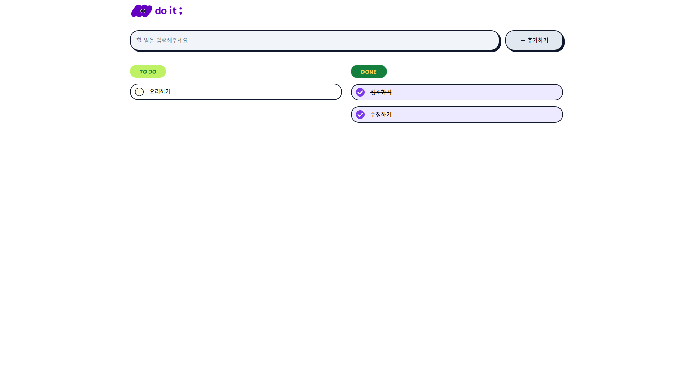
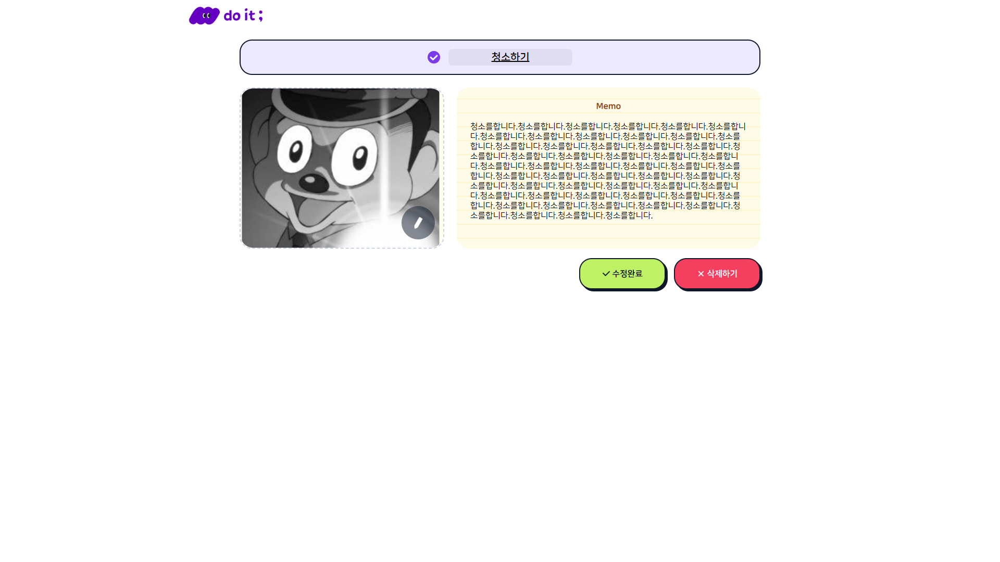
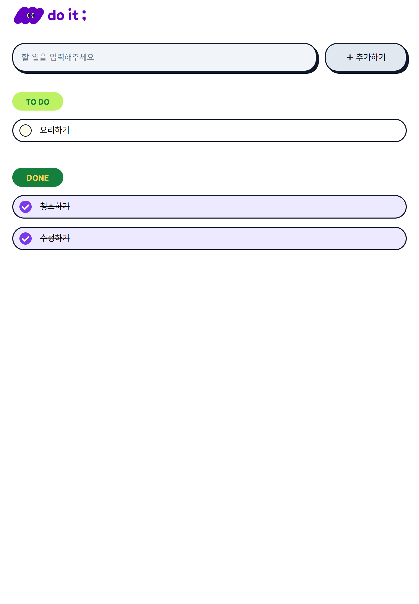
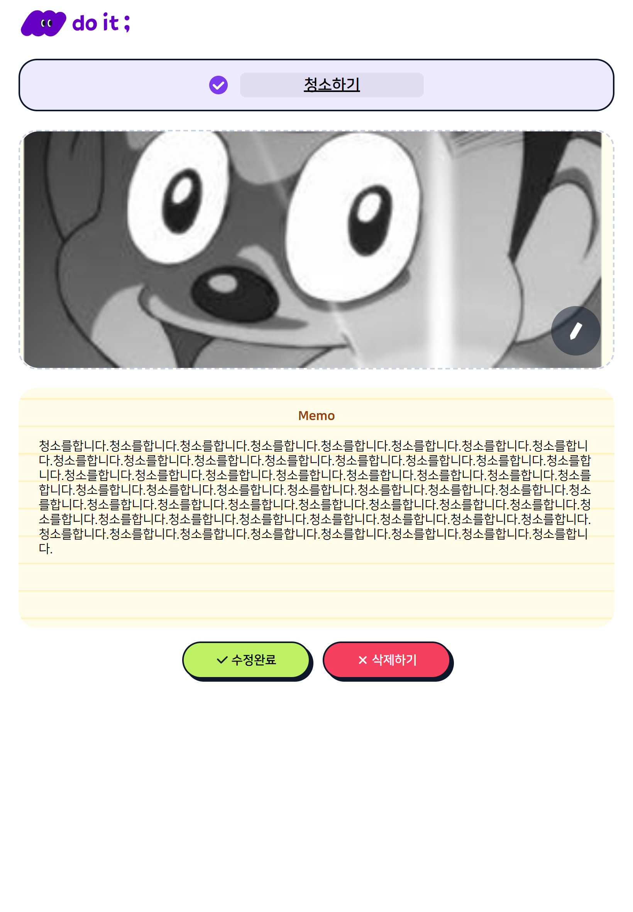
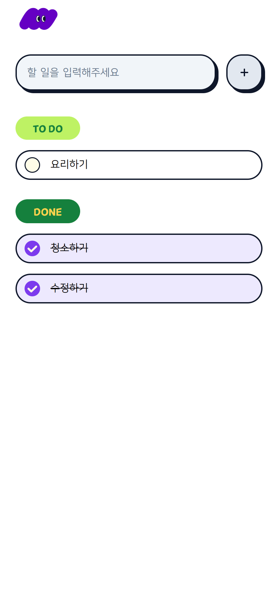
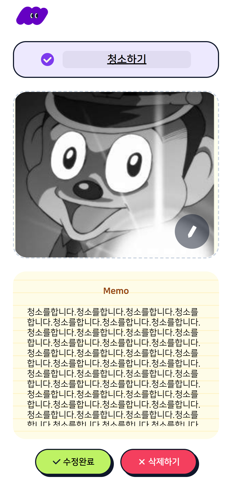

# do it; — Todo List

할 일을 추가하고, 진행 중 / 완료로 나누어 관리하며, 상세 페이지에서 이름·상태·메모·이미지를 수정하거나 삭제할 수 있는 Todo 서비스입니다.
Vite + React로 처음 만든 뒤, 컴포넌트를 정리하고 Next.js App Router로 전환했습니다.

- 배포 링크: https://hodonee-do-it-todo-nextjs.vercel.app
- API 문서: https://assignment-todolist-api.vercel.app/docs/

## 화면

| | 목록 | 상세 |
|:---:|:---:|:---:|
| **데스크톱** |  |  |
| **태블릿** |  |  |
| **모바일** |  |  |


## 기술 스택

| 구분 | 사용 기술 |
|---|---|
| 프레임워크 | Next.js 16 (App Router), React 19 |
| 언어 | TypeScript |
| 스타일 | CSS (컴포넌트별 CSS 파일, CSS 변수로 색상·폰트 관리) |
| 데이터 요청 | fetch (`src/api/todos.ts`) |
| 린트 | oxlint |

## 주요 기능

### 할 일 목록 페이지 (`/`)
- 로고 클릭 시 `/`로 새로고침 이동
- 진행 중(TO DO) / 완료(DONE) 할 일을 나누어 표시, 비어 있으면 안내 일러스트 표시
- 입력창에 입력 후 `추가하기` 버튼 또는 Enter로 할 일 추가 (요청 중 중복 추가 방지)
- 체크 버튼으로 진행 중 ↔ 완료 전환 (서버 저장 후 화면 반영)
- 항목 클릭 시 상세 페이지로 이동

### 할 일 상세 페이지 (`/items/{itemId}`)
- 할 일 이름, 진행/완료 상태, 메모 수정
- 이미지 1개 첨부 (이미지 파일, 영문 파일명, 5MB 이하)
- 이미지 업로드 중에는 `수정완료` 버튼 비활성화
- `수정완료` 시 변경 사항 저장 후 목록으로 이동
- `삭제하기` 시 확인 후 삭제하고 목록으로 이동
- 불러오는 중 / 존재하지 않는 할 일 안내

### 공통
- Figma 디자인의 색상·폰트를 `src/app/globals.css`의 CSS 변수로 등록해 사용
- 반응형: 모바일(~768px), 태블릿(769px~1024px), 데스크톱(1025px~)
- 나눔스퀘어 폰트 적용

## 시작하기

```bash
# 1. 패키지 설치
npm install

# 2. 개발 서버 실행 → http://localhost:3000
npm run dev
```

| 스크립트 | 설명 |
|---|---|
| `npm run dev` | 개발 서버 실행 |
| `npm run build` | 프로덕션 빌드 |
| `npm run start` | 빌드 결과 실행 |
| `npm run lint` | oxlint 검사 |

## 폴더 구조

```
src/
├─ app/
│  ├─ layout.tsx               # 공통 레이아웃 (Header, 폰트, metadata)
│  ├─ page.tsx                 # 목록 페이지
│  ├─ globals.css              # 전역 스타일, 색상·폰트 변수
│  ├─ icon.png                 # 파비콘
│  └─ items/[itemId]/page.tsx  # 상세 페이지
├─ api/todos.ts                # 할 일 조회·추가·수정·삭제, 이미지 업로드 요청
├─ components/
│  ├─ common/                  # 공통: Header, SearchInput
│  └─ todo/                    # 목록: TodoForm, TodoList, TodoSection, TodoListItem
│                              # 상세: TodoDetailItem, TodoImageUploader, TodoMemo
├─ types/TodoType.ts           # Todo 타입
├─ utils/validateImage.ts      # 이미지 파일 형식·이름·용량 검사
└─ assets/                     # 아이콘, 이미지
```

## 구현 메모

- **로고 새로고침**: `next/link`는 페이지를 새로고침하지 않아서 `<a href="/">`를 사용했습니다.
- **추가 시 Enter**: `<form onSubmit>`으로 버튼 클릭과 Enter를 같은 방식으로 처리합니다.
- **목록 개수**: API `pageSize` 기본값이 10이라, 모든 항목이 보이도록 100으로 요청합니다.
- **같은 이미지 다시 선택**: 파일 선택 후 input 값을 비워 같은 파일도 다시 고를 수 있게 했습니다.
- **업로드 상태 위치**: `isUploading`은 업로더와 저장 버튼이 함께 쓰므로 페이지에서 관리하고 props로 전달합니다.

## Refactoring · Next.js 전환 과정

전환 전에 컴포넌트를 먼저 정리해서, 옮겨야 할 범위를 줄였습니다.

1. `Todo` 타입을 `types/`로 분리
2. 할 일 / 완료 영역의 중복 마크업을 `TodoSection` 하나로 통합 (`variant`로 제목·안내 문구 구분)
3. 이미지 검사 로직을 `validateImage()` 순수 함수로 분리 (메시지 반환, 알림은 호출하는 쪽에서)
4. 상세 페이지를 `TodoImageUploader`, `TodoMemo`로 분리
5. Vite + React Router → Next.js App Router 전환

## 트러블슈팅

| 문제 | 원인 | 해결 |
|---|---|---|
| ``에서 이미지가 깨짐 | Next에서 이미지 import는 문자열이 아니라 `StaticImageData` 객체 | `icon.src` 사용 |
| `import './x.css'`에서 타입 에러 | TypeScript가 side-effect import도 타입을 확인 (Vite에서는 `vite/client` 타입이 처리) | `noUncheckedSideEffectImports: false` |
| `next build` 타입 검사 실패 | `noUnusedLocals`가 Next가 자동 생성한 `.next/` 타입 파일까지 검사 | 해당 옵션을 제거하고, 미사용 변수는 oxlint로 검사 |
| `src/pages` 폴더 충돌 | Next에서 `pages`는 Pages Router 예약 폴더 | 페이지를 `app/` 라우트로 이동 |

